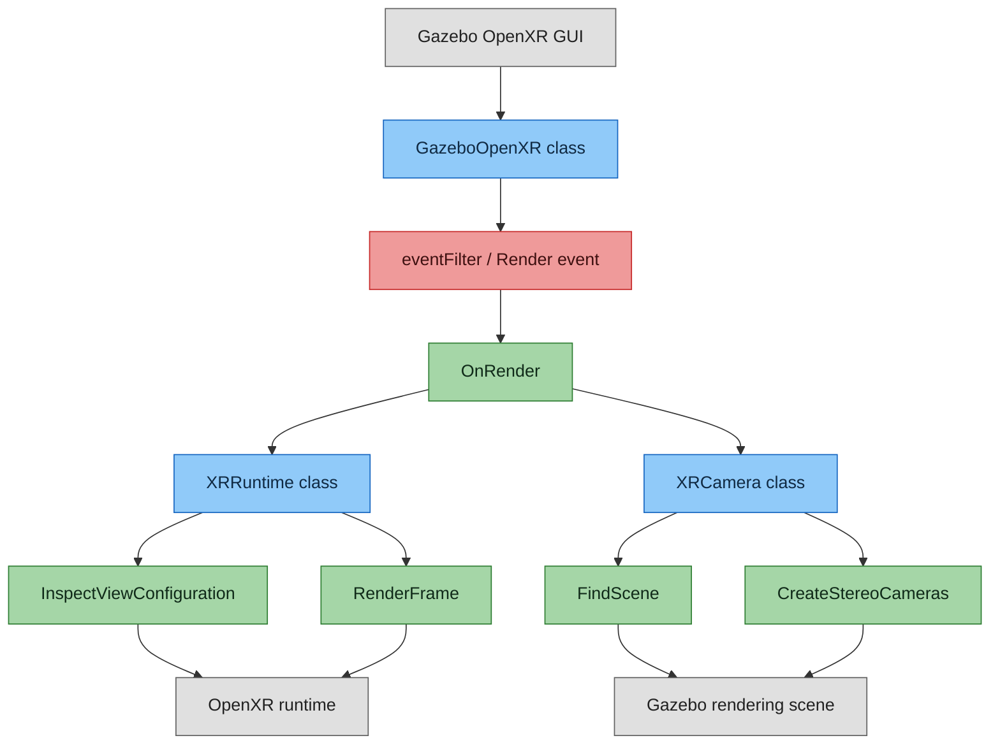

# $\color{#00c853}{\text{Gazebo Rendering နှင့် OpenXR Diagnostic}}$

ဤ project သည် Gazebo Harmonic `gz-rendering8` scene ကို ရှာဖွေပြီး diagnostic stereo camera နှစ်လုံး ဖန်တီးကာ OpenXR stereo view configuration နှင့် swapchain format များကို စစ်ဆေးသည်။

Project: [openxr_ws/gz-harmonic/gazebo_openxr_step2_rendering8](../openxr_ws/gz-harmonic/gazebo_openxr_step2_rendering8)

## $\color{red}{\text{လုပ်ဆောင်ပုံ}}$



- Session running ဖြစ်မှ ရရှိထားပြီးသား Gazebo scene တစ်ခုကို ရှာပြီး camera နှစ်လုံး ဖန်တီးသည်။ Scene သို့မဟုတ် engine တစ်ခုထက်ပိုရှိလျှင် ရွေးချယ်မထားဘဲ စောင့်ပြီး terminal တွင် အသိပေးသည်။
- Camera များမှာ စမ်းသပ်ရန် `1024 x 1024` နှင့် IPD `0.064 m` သတ်မှတ်ထားသည်။ အမှန်တကယ် headset ၏ view pose နှင့် resolution မဟုတ်ပါ။
- Runtime ကပေးသော stereo view resolution၊ sample count နှင့် supported OpenGL swapchain format များကို terminal တွင် ပြသည်။ Value များသည် runtime နှင့် headset အလိုက် ကွာနိုင်သည်။
- Frame loop သည် composition layer မပါသော diagnostic frame များသာ ပို့သည်။ Swapchain ဖန်တီးခြင်း၊ camera texture rendering၊ head tracking၊ controller input နှင့် headset ထဲ Gazebo scene ပြခြင်း **မပါသေးပါ**။
- Stop ပြီး session ပိတ်သွားလျှင် camera များကို render event တွင် ဖျက်သည်။ Plugin ကို unload မလုပ်မီ session ကို ရပ်ပါ။ World ပြောင်းခြင်းနှင့် session အလုပ်လုပ်နေစဉ် plugin unload လုပ်ခြင်းကို ဤ diagnostic အဆင့်တွင် မအာမခံပါ။

## $\color{red}{\text{Q1. VR headset မပါဘဲ project ကို run လို့ရသလား}}$

ရပါသည်။ Gazebo GUI နှင့် plugin panel ကို VR headset မပါဘဲ ဖွင့်နိုင်သည်။ သို့သော် runtime နှင့် headset မရှိဘဲ OpenXR session မစနိုင်သောကြောင့် session running ဖြစ်မှ လုပ်ဆောင်သည့် scene ရှာဖွေခြင်း၊ stereo camera ဖန်တီးခြင်းနှင့် view/format inspection ကို စမ်းသပ်၍မရပါ။

## $\color{red}{\text{Q2. Build ပြီးသား project ကို ဘယ်လို run မလဲ}}$

Repository root မှ အောက်ပါ command များကို terminal တစ်ခုတည်းတွင် run ပါ။

```bash
# GUI
cd ~/Desktop/Git/openxr_developers/openxr_ws/gz-harmonic/gazebo_openxr_step2_rendering8
export GZ_GUI_PLUGIN_PATH="$PWD/build"
gz sim --force-version 8 -v 4 shapes.sdf
```

Gazebo ၏ ညာဘက်အပေါ်ရှိ **⋮** မှ **GazeboOpenXR** ကိုရွေးပါ။ Panel သည် ညာဘက်အောက်တွင် ပေါ်နိုင်သဖြင့် လိုအပ်လျှင် scroll ဆင်းပါ။

Panel ကို အပြည့်မမြင်ရလျှင် title bar ရှိ **□** ဖြင့် floating ပြောင်း၍ ရွှေ့နိုင်သည်။ Panel အတွင်း နေရာမလုံလောက်လျှင် scroll လုပ်နိုင်သည်။ Docked panel ကို မြင်ကွင်းအောက်တွင် ရှာမတွေ့ပါက ညာဘက်အစွန်ရှိ scrollbar ကို ဆွဲပါ။

OpenXR session ကိုစမ်းရန် WiVRn ကဲ့သို့ runtime နှင့် headset ကို ချိတ်ဆက်ပြီး **Check OpenXR Runtime**၊ ထို့နောက် **Start VR Session** ကိုနှိပ်ပါ။ ဤ project ၏ session သည် Linux X11/GLX OpenGL context ကို အသုံးပြုသည်။ Runtime သို့မဟုတ် context မရလျှင် panel နှင့် terminal ရှိ error ကို စစ်ပါ။

## $\color{red}{\text{Build နှင့် စစ်ဆေးခြင်း}}$

Gazebo Harmonic development packages၊ `libgz-rendering8-dev`၊ OpenXR loader/development headers၊ Qt 5၊ OpenGL နှင့် X11 development libraries လိုအပ်သည်။ အသေးစိတ် dependency စာရင်းကို [စတင်တည်ဆောက်ခြင်း](./01_start_gazebo_harmonic_project.md) တွင် ကြည့်ပါ။

```bash
# CLI
cd ~/Desktop/Git/openxr_developers/openxr_ws/gz-harmonic/gazebo_openxr_step2_rendering8
cmake -S . -B build -DCMAKE_BUILD_TYPE=Release
cmake --build build -j8
ldd -r build/libGazeboOpenXR.so
```

`ldd -r` output တွင် `not found` သို့မဟုတ် `undefined symbol` မရှိရပါ။ Headset ချိတ်ပြီး session စတင်လျှင် terminal တွင် `[XRCamera] Gazebo Scene Ready`၊ `[XRCamera] Stereo Cameras Created`၊ `[XRRuntime] View count` နှင့် supported format များကို ကြည့်နိုင်သည်။ Inspection မအောင်မြင်လျှင် status တွင် အမှားပြပြီး session အသစ်စတင်မှ ထပ်ကြိုးစားသည်။
