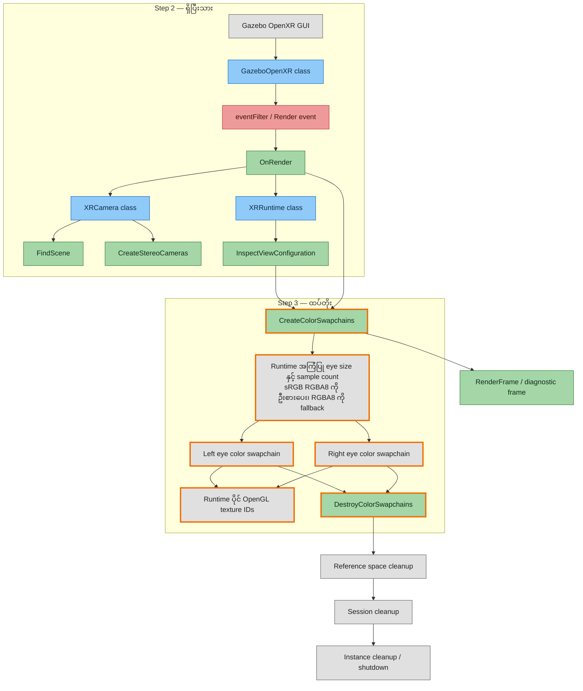

# $\color{#00c853}{\text{OpenXR Stereo Swapchain ဖန်တီးခြင်း}}$

Project: [openxr_ws/gz-harmonic/gazebo_openxr_step3_create_swapchain](../openxr_ws/gz-harmonic/gazebo_openxr_step3_create_swapchain)။

## $\color{red}{\text{Step 2 နှင့် Step 3 လုပ်ဆောင်ပုံ}}$

လိမ္မော်ရောင် ဘောင်များသည် [step 2](./02_render.md) ထက် ထပ်တိုးထားသော အပိုင်းများဖြစ်သည်။ Swapchain size သည် runtime က eye တစ်ဖက်စီအတွက် ပေးသည့် recommended value ဖြစ်ပြီး ပုံသေ resolution မဟုတ်ပါ။

Swapchain image များကို enumerate လုပ်သော်လည်း Gazebo camera texture ကို copy/render မလုပ်သေးသလို composition layer လည်း မပို့သေးပါ။ ထို့ကြောင့် headset ထဲ Gazebo scene မပေါ်သေးပါ။ Texture များကို OpenXR runtime က ပိုင်ဆိုင်သည်။

## $\color{red}{\text{Q1. VR headset မပါဘဲ run လို့ရသလား}}$

Gazebo GUI နှင့် plugin panel ကို ဖွင့်နိုင်သည်။ Swapchain ဖန်တီးခြင်းကို စမ်းရန် OpenXR runtime၊ headset နှင့် အသုံးပြုနိုင်သော GLX context လိုသည်။

## $\color{red}{\text{Q2. Project ကို ဘယ်လိုဖွင့်မလဲ}}$

Step 2 ၏ [build နှင့် run လမ်းညွှန်](./02_render.md) အတိုင်း အသုံးပြုနိုင်ပြီး project directory နှင့် GUI plugin path ကို အပေါ်ပါ step 3 project ၏ directory နှင့် build directory သို့ ပြောင်းသတ်မှတ်ပါ။ Gazebo ၏ **⋮** menu မှ **GazeboOpenXR** ကိုရွေးပြီး **Start VR Session** ကိုနှိပ်ပါ။ Step 2 နှင့် step 3 plugin များ အမည်တူသောကြောင့် မိမိစမ်းမည့် build directory ကိုသာ GUI plugin path တွင် ထည့်ပါ။

Panel ကို အပြည့်မမြင်ရလျှင် title bar ရှိ **□** ဖြင့် floating ပြောင်း၍ ရွှေ့နိုင်သည်။ Panel အတွင်း နေရာမလုံလောက်လျှင် scroll လုပ်နိုင်သည်။ Docked panel ကို မြင်ကွင်းအောက်တွင် ရှာမတွေ့ပါက ညာဘက်အစွန်ရှိ scrollbar ကို ဆွဲပါ။

Session ရပ်ပြီးမှ plugin ကို unload လုပ်ပါ။ Swapchain ဖန်တီးမှု မအောင်မြင်လျှင် status တွင် အမှားပြကာ session ကို ရပ်ရန်တောင်းဆိုသည်။
