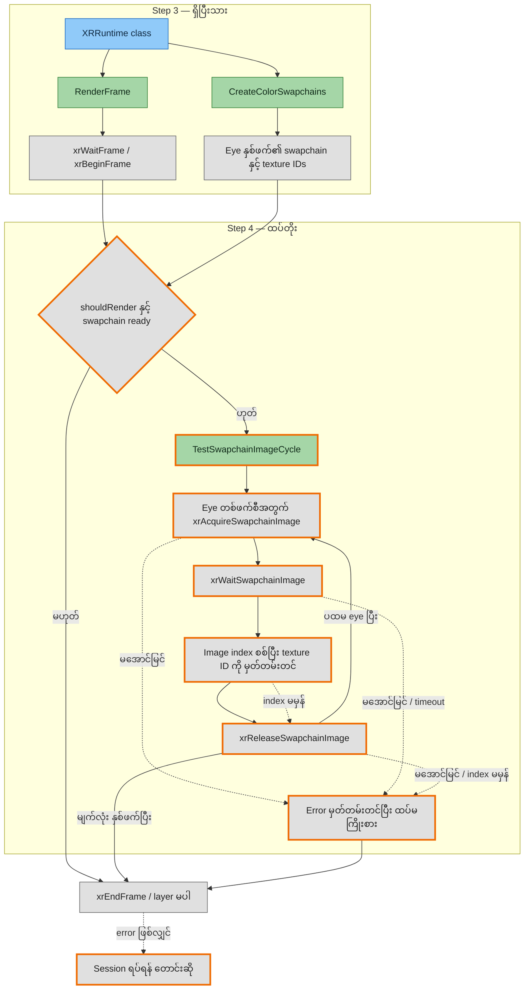

# $\color{#00c853}{\text{OpenXR Swapchain Image Acquire}}$

Project: [openxr_ws/gz-harmonic/gazebo_openxr_step4_swapchainImageAcquire](../openxr_ws/gz-harmonic/gazebo_openxr_step4_swapchainImageAcquire)။
Reference: [04_Step24:SwapchainImageAcquire.md](./04_Step24:SwapchainImageAcquire.md)။

## $\color{red}{\text{Step 3 ထက် ထပ်တိုးထားသည်များ}}$



လိမ္မော်ရောင် ဘောင်များသည် [Step 3](./03_SwapChainCreate.md) ထက် ထပ်တိုးထားသော အပိုင်းများဖြစ်သည်။ `shouldRender` မှန်ပြီး swapchain အဆင်သင့်ဖြစ်သော frame များတွင် eye တစ်ဖက်စီ၏ image ကို acquire၊ wait၊ release အစဉ်လိုက် လုပ်သည်။ Frame ၁၂၀ တိုင်း image index နှင့် runtime ပိုင် OpenGL texture ID ကို terminal တွင် ပြသည်။

ဤအဆင့်တွင် texture ထဲသို့ Gazebo scene ကို မရေးသေးပါ။ `xrEndFrame` သို့ composition layer မပို့သေးသောကြောင့် headset ထဲတွင် Gazebo scene မပေါ်သေးပါ။ Image index နှင့် texture ID များသည် runtime အလိုက် ကွာနိုင်သည်။

Acquire၊ wait၊ release သို့မဟုတ် index စစ်ဆေးမှု မအောင်မြင်လျှင် error ကို panel နှင့် terminal တွင် ပြပြီး ထပ်မကြိုးစားပါ။ Begin လုပ်ပြီးသော frame ကို layer မပါဘဲ end လုပ်ကာ session ရပ်ရန် တောင်းဆိုသည်။ Wait မအောင်မြင်သော image ကို release မလုပ်ဘဲ session ပိတ်ပြီး ပြန်စတင်မှ ထပ်စမ်းပါ။ Wait သည် `XR_INFINITE_DURATION` သုံးသောကြောင့် runtime မတုံ့ပြန်လျှင် render thread စောင့်နေနိုင်သည်။

## $\color{red}{\text{Q1. VR headset မပါဘဲ run လို့ရသလား}}$

Gazebo GUI နှင့် plugin panel ကို ဖွင့်နိုင်သည်။ အမှန်တကယ် image acquire၊ wait၊ release စမ်းရန် OpenXR runtime၊ headset နှင့် Linux X11/GLX OpenGL context လိုသည်။ Mock test များကို headset မပါဘဲ run နိုင်သည်။

## $\color{red}{\text{Q2. Project ကို ဘယ်လိုဖွင့်မလဲ}}$

Gazebo Harmonic၊ OpenXR၊ Qt 5၊ OpenGL နှင့် X11 development dependencies လိုသည်။ Build နှင့် test ကို အောက်ပါအတိုင်း လုပ်ပါ။

```bash
# CLI
cd ~/Desktop/Git/openxr_developers/openxr_ws/gz-harmonic/gazebo_openxr_step4_swapchainImageAcquire
cmake -S . -B build -DCMAKE_BUILD_TYPE=Release
cmake --build build -j8
ctest --test-dir build --output-on-failure
```

တူညီသော terminal တွင် Gazebo ကို ဖွင့်ပါ။

```bash
# GUI
export GZ_GUI_PLUGIN_PATH="$PWD/build"
gz sim --force-version 8 -v 4 shapes.sdf
```

Plugin အားလုံး အမည်တူသောကြောင့် စမ်းမည့် Step 4 build path ကိုသာ `GZ_GUI_PLUGIN_PATH` တွင် ထည့်ပါ။ Gazebo ၏ **⋮** မှ **GazeboOpenXR** ကိုရွေးပါ။ Panel သည် မြင်ကွင်းအောက်ရောက်နေလျှင် sidebar scrollbar ကို ဆွဲပါ။ Panel title bar ရှိ **□** ဖြင့် floating ပြောင်းနိုင်ပြီး panel အတွင်း နေရာမလုံလောက်လျှင် scroll လုပ်နိုင်သည်။

WiVRn ကဲ့သို့ runtime နှင့် headset ချိတ်ပြီး **Check OpenXR Runtime**၊ ထို့နောက် **Start VR Session** ကိုနှိပ်ပါ။ Session running ဖြစ်ပြီး `shouldRender` မှန်ပါက terminal တွင် `[XRRuntime] Eye 0 acquired image` နှင့် `Eye 1 acquired image` log များကို ကြည့်နိုင်သည်။ Session ရပ်ပြီးမှ plugin ကို unload လုပ်ပါ။