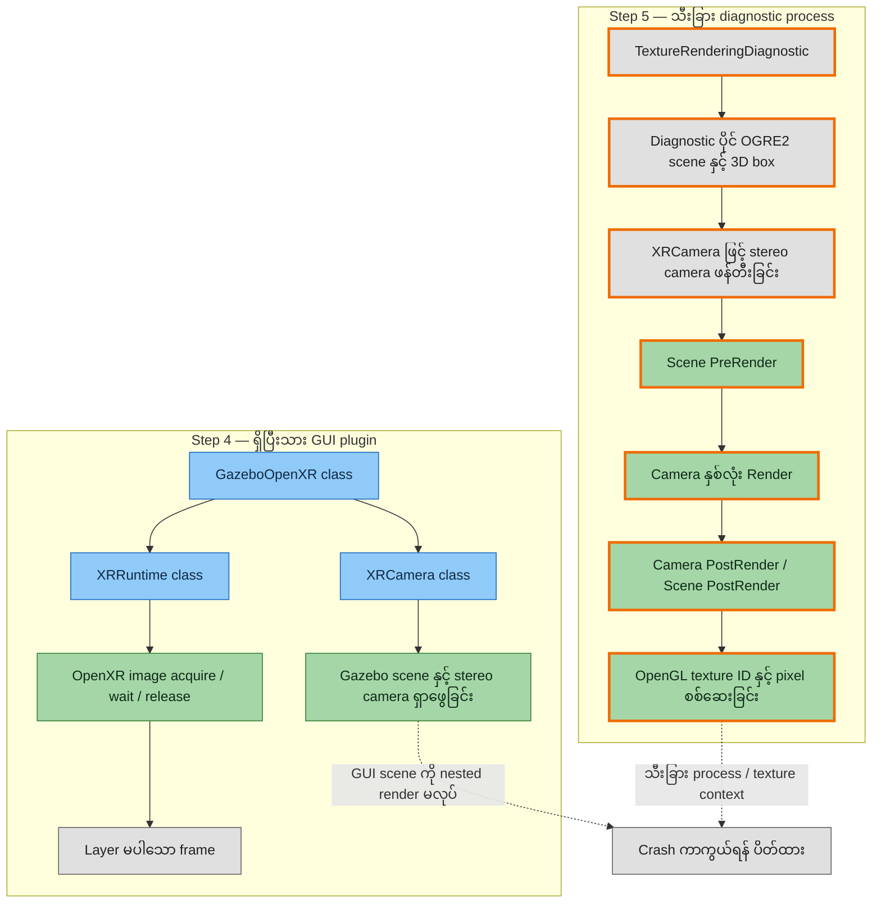

# $\color{#00c853}{\text{Gazebo Stereo Texture Rendering Diagnostic}}$

Project: [openxr_ws/gz-harmonic/gazebo_openxr_step5_texture_rendering](../openxr_ws/gz-harmonic/gazebo_openxr_step5_texture_rendering)။
Reference: [05_Step25:GazeboTextureRendering.md](./05_Step25:GazeboTextureRendering.md)။

## $\color{red}{\text{Step 4 ထက် ထပ်တိုးထားသည်များ}}$



လိမ္မော်ရောင် ဘောင်များသည် [Step 4](./04_SwapchainImageAcquire.md) ထက် ထပ်တိုးထားသော အပိုင်းများဖြစ်သည်။ သီးခြား executable က မိမိပိုင် OGRE2 scene တွင် stereo camera နှစ်လုံးနှင့် 3D box တစ်ခု ဖန်တီးသည်။ Frame နှစ်ခု render လုပ်ပြီး eye တစ်ဖက်စီ၏ texture ID၊ box pixel နှင့် ပြောင်းလဲသော background pixel ကို စစ်သည်။ Camera တစ်လုံးစီ၏ `Update()` မဟုတ်ဘဲ scene နှင့် camera များ၏ `PreRender`၊ `Render`၊ `PostRender` lifecycle ကို အသုံးပြုသည်။

Reference တွင် Gazebo GUI ၏ ရှိပြီးသား scene အပေါ် `PreRender()` ထပ်ခေါ်ရာ OGRE2 assertion ဖြစ်ခဲ့သည်။ ထို့ကြောင့် GUI plugin မှ nested camera rendering ကို **မခေါ်ပါ**။ သီးခြား diagnostic သည် စမ်းသပ် scene သာဖြစ်ပြီး Gazebo simulation world မဟုတ်ပါ။ Texture ID များသည် diagnostic process နှင့် ၎င်း၏ OpenGL context အတွက်သာဖြစ်သည်။

GUI plugin သည် Step 4 ၏ camera ဖန်တီးမှုနှင့် OpenXR swapchain image cycle ကို ဆက်ထိန်းထားသည်။ Gazebo texture ကို OpenXR image သို့ copy မလုပ်သေးသလို composition layer လည်း မပို့သေးသောကြောင့် headset ထဲ Gazebo scene မပေါ်သေးပါ။

## $\color{red}{\text{Q1. VR headset မပါဘဲ run လို့ရသလား}}$

ရပါသည်။ သီးခြား texture diagnostic နှင့် Gazebo GUI panel အတွက် VR headset မလိုပါ။ Diagnostic အတွက် OGRE2 နှင့် အသုံးပြုနိုင်သော X11 display / OpenGL လိုသည်။ OpenXR session နှင့် swapchain cycle အတွက်မူ runtime၊ headset နှင့် GLX context လိုသည်။

## $\color{red}{\text{Q2. Project ကို ဘယ်လိုဖွင့်မလဲ}}$

Gazebo Harmonic၊ OGRE2 rendering plugin၊ OpenXR၊ Qt 5၊ OpenGL နှင့် X11 development dependencies လိုသည်။ Build နှင့် test လုပ်ပါ။

```bash
# CLI
cd ~/Desktop/Git/openxr_developers/openxr_ws/gz-harmonic/gazebo_openxr_step5_texture_rendering
cmake -S . -B build -DCMAKE_BUILD_TYPE=Release
cmake --build build -j8
ctest --test-dir build --output-on-failure
```

Display မရလျှင် CTest သည် texture diagnostic ကို **skipped** ပြမည်။ Display ရှိသော terminal မှ diagnostic ကို တိုက်ရိုက် စမ်းနိုင်သည်။

```bash
# CLI
./build/TextureRenderingDiagnostic
```

အောင်မြင်လျှင် left/right texture ID များနှင့် `Stereo texture rendering verified` ကို terminal တွင် ပြမည်။ ID များသည် run တစ်ကြိမ်နှင့်တစ်ကြိမ် ကွာနိုင်သည်။

GUI plugin ကို စမ်းရန် တူညီသော project directory မှ run ပါ။

```bash
# GUI
export GZ_GUI_PLUGIN_PATH="$PWD/build"
gz sim --force-version 8 -v 4 shapes.sdf
```

Gazebo ၏ **⋮** မှ **GazeboOpenXR** ကိုရွေးပါ။ Plugin အမည်များတူသောကြောင့် Step 5 build path ကိုသာ `GZ_GUI_PLUGIN_PATH` တွင် ထည့်ပါ။ Panel ကို အပြည့်မမြင်ရလျှင် sidebar scrollbar ကို ဆွဲပါ သို့မဟုတ် title bar မှ floating ပြောင်းပါ။ Panel အတွင်းလည်း လိုအပ်လျှင် scroll လုပ်နိုင်သည်။ Session စမ်းရန် runtime နှင့် headset ချိတ်ပြီး **Check OpenXR Runtime**၊ ထို့နောက် **Start VR Session** ကိုနှိပ်ပါ။ Session ရပ်ပြီးမှ plugin ကို unload လုပ်ပါ။