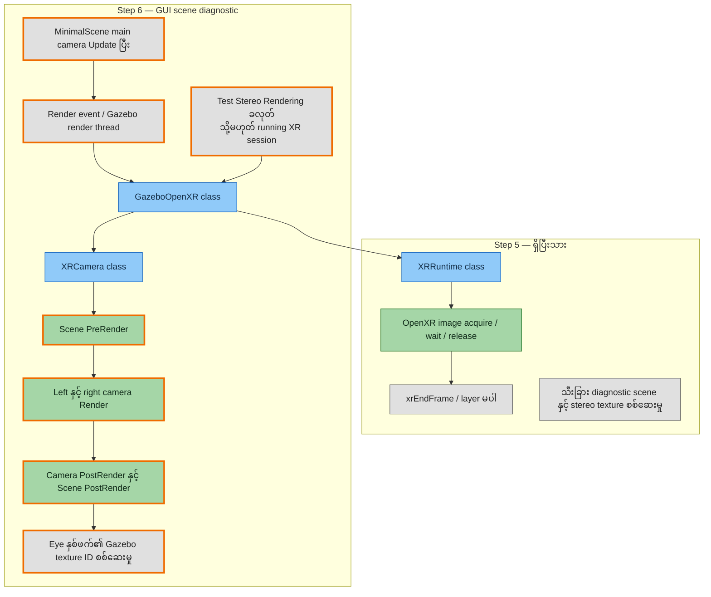

# $\color{#00c853}{\text{Coordinated Stereo Rendering}}$

Project: [openxr_ws/gz-harmonic/gazebo_openxr_step6_coordinated_stero_rendering](../openxr_ws/gz-harmonic/gazebo_openxr_step6_coordinated_stero_rendering)။
Reference: [06_Step26:CoordinatedSteroRendering.md](./06_Step26:CoordinatedSteroRendering.md)။

## $\color{red}{\text{Step 5 ထက် ထပ်တိုးထားသည်များ}}$



လိမ္မော်ရောင် ဘောင်များသည် [Step 5](./05_TextureRendering.md) ထက် ထပ်တိုးထားသော အပိုင်းများဖြစ်သည်။ ယခု GUI scene ၏ render thread ပေါ်တွင် stereo camera နှစ်လုံးကို **scene cycle တစ်ခုတည်း** အတွင်း render လုပ်ပြီး `Scene::PostRender()` ဖြင့် cycle ကို အဆုံးသတ်သည်။ OpenGL texture ID များကို terminal တွင် ပြသည်။ Scene တစ်ခုအတွက် အောင်မြင်သည်ဖြစ်စေ မအောင်မြင်သည်ဖြစ်စေ တစ်ကြိမ်သာ ကြိုးစားသည်။

Gazebo GUI 8.5 `MinimalScene` တွင် `Render` event သည် main camera ၏ `Update()` ပြီးနောက် လာသည်။ ဤ diagnostic သည် ထို lifecycle အပေါ် မူတည်သည်။ အခြား scene provider၊ renderer သို့မဟုတ် Gazebo version များတွင် lifecycle တူညီကြောင်း မအာမခံပါ။ အပို scene cycle ကြောင့် rendering overhead နှင့် scene post-render update များ ထပ်ဖြစ်နိုင်သဖြင့် production integration အဖြစ် မယူဆပါနှင့်။

Step 5 ၏ သီးခြား scene diagnostic လည်း ပါရှိသေးသည်။ GUI scene ရှိ texture ကို OpenXR image သို့ copy မလုပ်သေးသလို GPU transfer synchronization၊ projection layer နှင့် head tracking မပါသေးပါ။ `xrEndFrame` သည် layer မပါသောကြောင့် headset ထဲ Gazebo scene မပေါ်သေးပါ။ Camera pose နှင့် resolution သည် diagnostic အတွက် ပုံသေဖြစ်သည်။

## $\color{red}{\text{Q1. VR headset မပါဘဲ run လို့ရသလား}}$

ရပါသည်။ Gazebo GUI တွင် **Test Stereo Rendering** ကို နှိပ်ပြီး headset မပါဘဲ GUI scene texture diagnostic စမ်းနိုင်သည်။ OGRE2၊ OpenGL နှင့် အသုံးပြုနိုင်သော X11 display လိုသည်။ OpenXR session နှင့် swapchain cycle အတွက်မူ runtime၊ headset နှင့် GLX context လိုသည်။

## $\color{red}{\text{Q2. Project ကို ဘယ်လိုဖွင့်မလဲ}}$

Gazebo Harmonic၊ OGRE2 rendering plugin၊ OpenXR၊ Qt 5၊ OpenGL နှင့် X11 development dependencies လိုသည်။ Build နှင့် test လုပ်ပါ။

```bash
# CLI
cd ~/Desktop/Git/openxr_developers/openxr_ws/gz-harmonic/gazebo_openxr_step6_coordinated_stero_rendering
cmake -S . -B build -DCMAKE_BUILD_TYPE=Release
cmake --build build -j8
ctest --test-dir build --output-on-failure
```

Texture diagnostic နှင့် MinimalScene GUI test တို့သည် X11 display မရလျှင် **skipped** ဖြစ်မည်။ သီးခြား scene diagnostic ကို `./build/TextureRenderingDiagnostic` ဖြင့်လည်း စမ်းနိုင်သည်။

တူညီသော project directory မှ GUI ဖွင့်ပါ။

```bash
# GUI
export GZ_GUI_PLUGIN_PATH="$PWD/build"
gz sim --force-version 8 -v 4 shapes.sdf
```

Gazebo ၏ **⋮** မှ **GazeboOpenXR** ကိုရွေးပါ။ Plugin အမည်များတူသောကြောင့် Step 6 build path ကိုသာ `GZ_GUI_PLUGIN_PATH` တွင် ထည့်ပါ။ Panel ကို အပြည့်မမြင်ရလျှင် sidebar scrollbar ကို ဆွဲပါ သို့မဟုတ် floating ပြောင်းပါ။ Panel အတွင်းလည်း scroll လုပ်နိုင်သည်။

**Test Stereo Rendering** ကို နှိပ်ပြီး terminal တွင် `[XRCamera] Coordinated Stereo Render SUCCESS` နှင့် eye နှစ်ဖက်၏ texture ID ကို စစ်ပါ။ Scene မရသေးလျှင် scene အဆင်သင့်ဖြစ်သည်အထိ စောင့်သည်။ အမှားဖြစ်ပါက panel နှင့် terminal ကို စစ်ပါ။ Session မရှိချိန် **Stop VR Session** နှိပ်လျှင် camera များကို ဖျက်ပြီး ပြန်စမ်းနိုင်သည်။

OpenXR session ကိုစမ်းရန် runtime နှင့် headset ချိတ်ပြီး **Check OpenXR Runtime**၊ ထို့နောက် **Start VR Session** ကိုနှိပ်ပါ။ Session running ဖြစ်ချိန်တွင်လည်း stereo diagnostic ကို အလိုအလျောက် ကြိုးစားသည်။ Session ရပ်ပြီးမှ plugin ကို unload လုပ်ပါ။ World ပြောင်းချိန်နှင့် running session အတွင်း plugin unload လုပ်ချိန် safety ကို မအာမခံပါ။