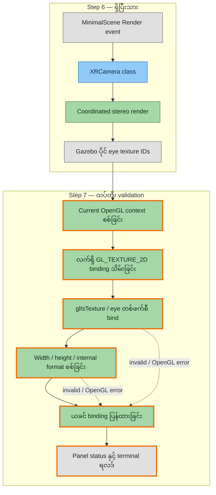

# $\color{#00c853}{\text{OpenGL Stereo Texture Validation}}$

Project: [openxr_ws/gz-harmonic/gazebo_openxr_step7_openGL_texture_validation](../openxr_ws/gz-harmonic/gazebo_openxr_step7_openGL_texture_validation)။
Reference: [07_Step27:OpenGLTextureValidation.md](./07_Step27:OpenGLTextureValidation.md)။

## $\color{red}{\text{Step 6 ထက် ထပ်တိုးထားသည်များ}}$



လိမ္မော်ရောင် ဘောင်များသည် [Step 6](./06_CoordinatedSteroRendering.md) ထက် ထပ်တိုးထားသော အပိုင်းများဖြစ်သည်။ Stereo render အောင်မြင်ပြီးနောက် Gazebo render thread ၏ current OpenGL context တွင် eye တစ်ဖက်စီ၏ texture object၊ `GL_TEXTURE_2D` target၊ အရွယ်အစားနှင့် internal format ကို စစ်သည်။ အောင်မြင်သည်ဖြစ်စေ validation အတွင်း error ဖြစ်သည်ဖြစ်စေ ယခင် texture binding ကို ပြန်ထားသည်။

Result နှင့် error ကို terminal တွင် ပြပြီး panel တွင် အောင်မြင်မှု သို့မဟုတ် failure ကို ပြသည်။ Scene တစ်ခုအတွက် validation ကို တစ်ကြိမ်သာ ကြိုးစားသည်။ Session မရှိချိန် **Stop VR Session** ဖြင့် camera များကို reset လုပ်ပြီး ပြန်စမ်းနိုင်သည်။ ရှိပြီးသား OpenGL error တွေ့လျှင် error ကို မှတ်တမ်းတင်ပြီး validation ကို ရပ်သည်။

ဤစစ်ဆေးမှုသည် texture object နှင့် metadata ကိုသာ အတည်ပြုသည်။ Pixel content မှန်ကန်မှု၊ အခြား OpenGL context နှင့် sharing၊ OpenXR image သို့ copy နှင့် GPU synchronization ကို မအာမခံပါ။ Composition layer မပို့သေးသောကြောင့် headset ထဲ Gazebo scene မပေါ်သေးပါ။ GUI scene lifecycle နှင့် ပတ်သက်သော [Step 6 ကန့်သတ်ချက်များ](./06_CoordinatedSteroRendering.md) သည် အတူတူ သက်ဆိုင်သည်။

## $\color{red}{\text{Q1. VR headset မပါဘဲ run လို့ရသလား}}$

ရပါသည်။ Gazebo GUI ၏ **Test Stereo Rendering** ဖြင့် texture validation ကို headset မပါဘဲ စမ်းနိုင်သည်။ OGRE2၊ OpenGL နှင့် X11 display လိုသည်။ OpenXR session နှင့် swapchain cycle အတွက်မူ runtime၊ headset နှင့် GLX context လိုသည်။

## $\color{red}{\text{Q2. Project ကို ဘယ်လိုဖွင့်မလဲ}}$

Gazebo Harmonic၊ OGRE2 rendering plugin၊ OpenXR၊ Qt 5၊ OpenGL နှင့် X11 development dependencies လိုသည်။ Build နှင့် test လုပ်ပါ။

```bash
# CLI
cd ~/Desktop/Git/openxr_developers/openxr_ws/gz-harmonic/gazebo_openxr_step7_openGL_texture_validation
cmake -S . -B build -DCMAKE_BUILD_TYPE=Release
cmake --build build -j8
ctest --test-dir build --output-on-failure
```

X11 display မရလျှင် OpenGL နှင့် MinimalScene GUI test များ **skipped** ဖြစ်မည်။ GUI plugin ကို တူညီသော project directory မှ ဖွင့်ပါ။

```bash
# GUI
export GZ_GUI_PLUGIN_PATH="$PWD/build"
gz sim --force-version 8 -v 4 shapes.sdf
```

Gazebo ၏ **⋮** မှ **GazeboOpenXR** ကိုရွေးပြီး **Test Stereo Rendering** ကို နှိပ်ပါ။ Plugin အမည်များတူသောကြောင့် Step 7 build path ကိုသာ `GZ_GUI_PLUGIN_PATH` တွင် ထည့်ပါ။ Panel ကို အပြည့်မမြင်ရလျှင် sidebar scrollbar ကို ဆွဲပါ သို့မဟုတ် floating ပြောင်းပါ။ Panel အတွင်းလည်း scroll လုပ်နိုင်သည်။

အောင်မြင်လျှင် terminal တွင် `Left Eye` နှင့် `Right Eye` တို့၏ texture ID၊ size၊ format နှင့် `Stereo Textures Validated` ကို ပြမည်။ ID နှင့် format သည် renderer အလိုက် ကွာနိုင်သည်။ OpenXR session running ဖြစ်ချိန်တွင်လည်း validation ကို အလိုအလျောက် ကြိုးစားသည်။ Session ရပ်ပြီးမှ plugin ကို unload လုပ်ပါ။