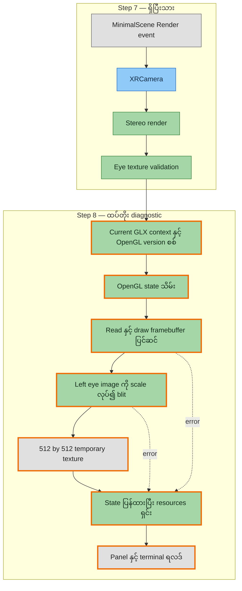

# $\color{#00c853}{\text{Gazebo Texture Transfer Diagnostic}}$

Project: [openxr_ws/gz-harmonic/gazebo_openxr_step8_texture_transfer](../openxr_ws/gz-harmonic/gazebo_openxr_step8_texture_transfer)။
Reference: [08_Step28:Gazebo_OpenXRTextureTransfer.md](./08_Step28:Gazebo_OpenXRTextureTransfer.md)။

## $\color{red}{\text{Step 7 ထက် ထပ်တိုးထားသည်များ}}$



လိမ္မော်ရောင် ဘောင်များသည် [Step 7](./07_OpenGLTextureValidation.md) ထက် ထပ်တိုးထားသော အပိုင်းများဖြစ်သည်။ Stereo render နှင့် texture validation အောင်မြင်ပြီးနောက် left eye texture ၏ အမှန်တကယ် အရွယ်အစားမှ `512×512` temporary `GL_RGBA8` texture သို့ `GL_LINEAR` ဖြင့် တစ်ကြိမ် scale လုပ်ကူးသည်။ Framebuffer ပြည့်စုံမှုနှင့် OpenGL error ကို စစ်ပြီး diagnostic အတွက် `glFinish` ဖြင့် ပြီးဆုံးသည်အထိ စောင့်သည်။

Read/draw framebuffer၊ texture နှင့် pixel unpack buffer binding များကို ပြန်ထားသည်။ Scissor ဖွင့်ထားလျှင် blit ကို မဖြတ်တောက်စေရန် ယာယီပိတ်ပြီး ပြန်ဖွင့်သည်။ Temporary framebuffer များ၏ buffer selection ကိုသာ ပြောင်းသဖြင့် မူလ framebuffer ၏ draw buffer များကို မပြောင်းပါ။ အောင်မြင်မှုနှင့် error ကို panel နှင့် terminal တွင် ပြသည်။ Reset ပြီးမှ ထပ်စမ်းနိုင်သည်။

Reference တွင် uninitialized framebuffer function pointer ကြောင့် crash ဖြစ်ခဲ့သည်။ ဤ project တွင် GLEW pointer မသုံးဘဲ OpenGL library ၏ core function များကို တိုက်ရိုက် link လုပ်ပြီး GLX context နှင့် OpenGL 3.0 အနည်းဆုံး ရှိကြောင်း စစ်သည်။ Linux GLX၊ OGRE2 နှင့် စမ်းသပ်ထားသော Gazebo GUI 8.5 `MinimalScene` lifecycle ပေါ် အခြေခံထားသည်။

**ကန့်သတ်ချက်:** ဤအဆင့်သည် temporary texture သို့ diagnostic copy သာဖြစ်သည်။ OpenXR swapchain သို့ မကူးသေး၊ projection layer မပို့သေး၊ continuous stereo rendering နှင့် head tracking မပါသေးပါ။ ထို့ကြောင့် headset ထဲ Gazebo scene မပေါ်သေးပါ။ Panel ၏ success သည် GL operations အောင်မြင်ကြောင်းသာ ပြသည်။ Pixel content နှင့် scaling ကို automated GLX test က သီးခြား readback ဖြင့် စစ်သည်။

## $\color{red}{\text{Q1. VR headset မပါဘဲ run လို့ရသလား}}$

ရပါသည်။ Gazebo GUI တွင် **Test Stereo Rendering** ကို နှိပ်ပြီး one-shot texture validation နှင့် framebuffer blit ကို စမ်းနိုင်သည်။ OGRE2၊ OpenGL 3.0 နှင့် X11 display လိုသည်။ OpenXR session နှင့် swapchain cycle အတွက်မူ OpenXR runtime၊ headset နှင့် GLX context လိုသည်။

## $\color{red}{\text{Q2. Project ကို ဘယ်လိုဖွင့်မလဲ}}$

Gazebo Harmonic၊ OGRE2 rendering plugin၊ OpenXR၊ Qt 5၊ OpenGL နှင့် X11 development dependencies များဖြင့် build နှင့် test လုပ်ပါ။

```bash
# CLI
cd ~/Desktop/Git/openxr_developers/openxr_ws/gz-harmonic/gazebo_openxr_step8_texture_transfer
cmake -S . -B build -DCMAKE_BUILD_TYPE=Release
cmake --build build -j4
ctest --test-dir build --output-on-failure
```

X11 display မရှိလျှင် OpenGL နှင့် live GUI test များ **skipped** ဖြစ်မည်။ တူညီသော project directory မှ GUI ဖွင့်ပါ။

```bash
# GUI
export GZ_GUI_PLUGIN_PATH="$PWD/build"
gz sim --force-version 8 -v 4 shapes.sdf
```

Gazebo ၏ **⋮** မှ **GazeboOpenXR** ကိုရွေးပြီး **Test Stereo Rendering** ကို နှိပ်ပါ။ Plugin အမည်များတူသောကြောင့် Step 8 build path ကိုသာ `GZ_GUI_PLUGIN_PATH` တွင် ထည့်ပါ။ Panel မပြည့်လျှင် sidebar သို့မဟုတ် panel အတွင်း scroll လုပ်နိုင်သည်။

အောင်မြင်လျှင် panel တွင် `Framebuffer blit succeeded (diagnostic)` နှင့် terminal တွင် `Framebuffer Blit SUCCESS` ပေါ်မည်။ မအောင်မြင်လျှင် terminal error ကို စစ်ပါ။ Session မရှိချိန် **Stop VR Session** ဖြင့် reset လုပ်ပြီး ပြန်စမ်းနိုင်သည်။ OpenXR session running ဖြစ်ချိန်တွင်လည်း diagnostic ကို အလိုအလျောက် ကြိုးစားသည်။ Plugin ကို unload မလုပ်မီ session ရပ်ပါ။