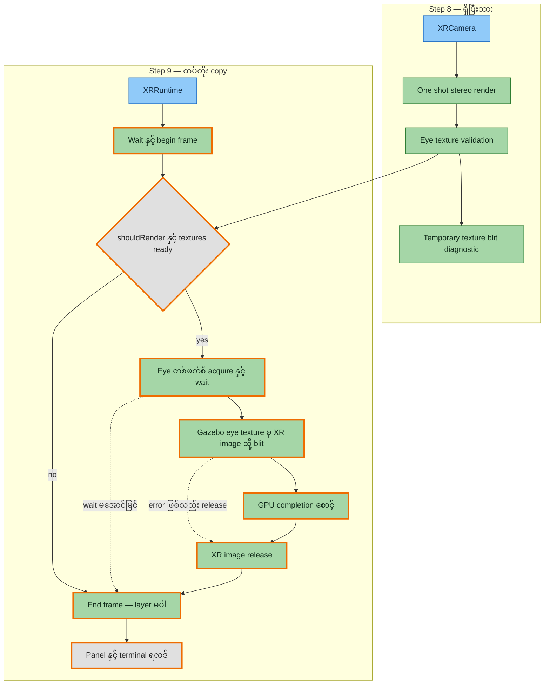

# $\color{#00c853}{\text{OGRE2 Render Copy to OpenXR}}$

Project: [openxr_ws/gz-harmonic/gazebo_openxr_step9_ogre2_render_copy_to_openxr](../openxr_ws/gz-harmonic/gazebo_openxr_step9_ogre2_render_copy_to_openxr)။
Reference: [09_Step29:OGRE2_RenderCopytoOpenXR.md](./09_Step29:OGRE2_RenderCopytoOpenXR.md)။

## $\color{red}{\text{Step 8 ထက် ထပ်တိုးထားသည်များ}}$



လိမ္မော်ရောင် ဘောင်များသည် [Step 8](./08_OpenXRTextureTransfer.md) ထက် ထပ်တိုးထားသော အပိုင်းများဖြစ်သည်။ `shouldRender` ဖြစ်ပြီး validated camera texture နှစ်ခုနှင့် swapchain များ ready ဖြစ်မှ eye တစ်ဖက်စီကို acquire → wait → framebuffer blit → release လုပ်သည်။ Source နှင့် destination ၏ အမှန်တကယ် texture အရွယ်အစားအတိုင်း scale လုပ်သည်။ Runtime က ပေးသော texture ကို မဖျက်ပါ။

Framebuffer copy သည် session ဖန်တီးခဲ့သော GLX context ပေါ်တွင်သာ လုပ်သည်။ Swapchain ကို `GL_TEXTURE_2D` blit နှင့်ကိုက်ညီရန် single sample ဖြင့် ဖန်တီးသည်။ `GL_SCISSOR_TEST` နှင့် `GL_FRAMEBUFFER_SRGB` ကို copy အတွက် ယာယီပိတ်ပြီး မူလ state ပြန်ထားသည်။ Reference အတိုင်း sRGB conversion ကို ယခုအဆင့်တွင် ပိတ်ထားသဖြင့် color accuracy ကို နောက်ပိုင်း သီးခြားစစ်ရန်လိုသည်။ GPU ပြီးစီးမှုအတွက် `glFinish` သုံးခြင်းသည် diagnostic အတွက်သာဖြစ်ပြီး performance ကုန်ကျသည်။

Copy မအောင်မြင်လျှင် wait အောင်မြင်ခဲ့သော image ကို release လုပ်ရန် ကြိုးစားပြီး၊ begin လုပ်ပြီးသား frame ကို end လုပ်ကာ error ပြသည်။ Acquire ပြီး wait မအောင်မြင်ပါက image ကို release မလုပ်ဘဲ session stop နှင့် teardown လုပ်သည်။ ထို session တွင် copy ပြန်မကြိုးစားပါ။ OpenGL core functions ကို တိုက်ရိုက် link လုပ်ပြီး GLX context နှင့် OpenGL 3.0 ကို စစ်သည့် [Step 8 နည်းလမ်း](./08_OpenXRTextureTransfer.md) ကို ဆက်သုံးသည်။

**ကန့်သတ်ချက်:** Eye texture များကို session frame တိုင်း copy လုပ်သော်လည်း Gazebo camera သည် one-shot diagnostic ဖြစ်သောကြောင့် image သည် static ဖြစ်သည်။ `xrEndFrame` သို့ projection layer မပို့သေးသဖြင့် headset ထဲ Gazebo scene မပေါ်သေးပါ။ Continuous rendering၊ head tracking နှင့် production error recovery မပါသေးပါ။

## $\color{red}{\text{Q1. VR headset မပါဘဲ run လို့ရသလား}}$

Gazebo GUI ၏ **Test Stereo Rendering** ဖြင့် Step 8 temporary texture diagnostic ကို headset မပါဘဲ စမ်းနိုင်သည်။ Automated tests တွင် mock OpenXR lifecycle နှင့် တကယ့် OpenGL texture pixel copy ကို သီးခြားစစ်သည်။ **တကယ့် OpenXR swapchain သို့ copy** စမ်းရန် OpenXR runtime၊ headset နှင့် X11/GLX context လိုသည်။

## $\color{red}{\text{Q2. Project ကို ဘယ်လိုဖွင့်မလဲ}}$

Gazebo Harmonic၊ OGRE2 rendering plugin၊ OpenXR၊ Qt 5၊ OpenGL နှင့် X11 development dependencies များဖြင့် build နှင့် test လုပ်ပါ။

```bash
# CLI
cd ~/Desktop/Git/openxr_developers/openxr_ws/gz-harmonic/gazebo_openxr_step9_ogre2_render_copy_to_openxr
cmake -S . -B build -DCMAKE_BUILD_TYPE=Release
cmake --build build -j4
ctest --test-dir build --output-on-failure
```

X11 display မရှိလျှင် OpenGL နှင့် live GUI test များ skipped ဖြစ်မည်။ တူညီသော project directory မှ GUI ဖွင့်ပါ။

```bash
# GUI
export GZ_GUI_PLUGIN_PATH="$PWD/build"
gz sim --force-version 8 -v 4 shapes.sdf
```

Gazebo ၏ **⋮** မှ **GazeboOpenXR** ကိုရွေးပါ။ VR မပါဘဲ စမ်းရန် **Test Stereo Rendering** ကို နှိပ်ပါ။ တကယ့် copy စမ်းရန် runtime နှင့် headset ကို ချိတ်ပြီး **Start VR Session** ကို နှိပ်ပါ။ Plugin အမည်များတူသောကြောင့် Step 9 build path ကိုသာ `GZ_GUI_PLUGIN_PATH` တွင် ထည့်ပါ။

ပထမ stereo copy အောင်မြင်လျှင် panel တွင် `Stereo swapchain copy succeeded (diagnostic)` နှင့် terminal တွင် `Stereo swapchain copy SUCCESS` ပေါ်မည်။ 120 frame တိုင်း eye တစ်ဖက်စီ၏ source နှင့် XR texture ID ကို log ထုတ်သည်။ Error ဖြစ်လျှင် terminal ကိုစစ်ပြီး session ရပ်ကာ ပြန်စတင်ပါ။ Plugin unload မလုပ်မီ session ရပ်ပါ။