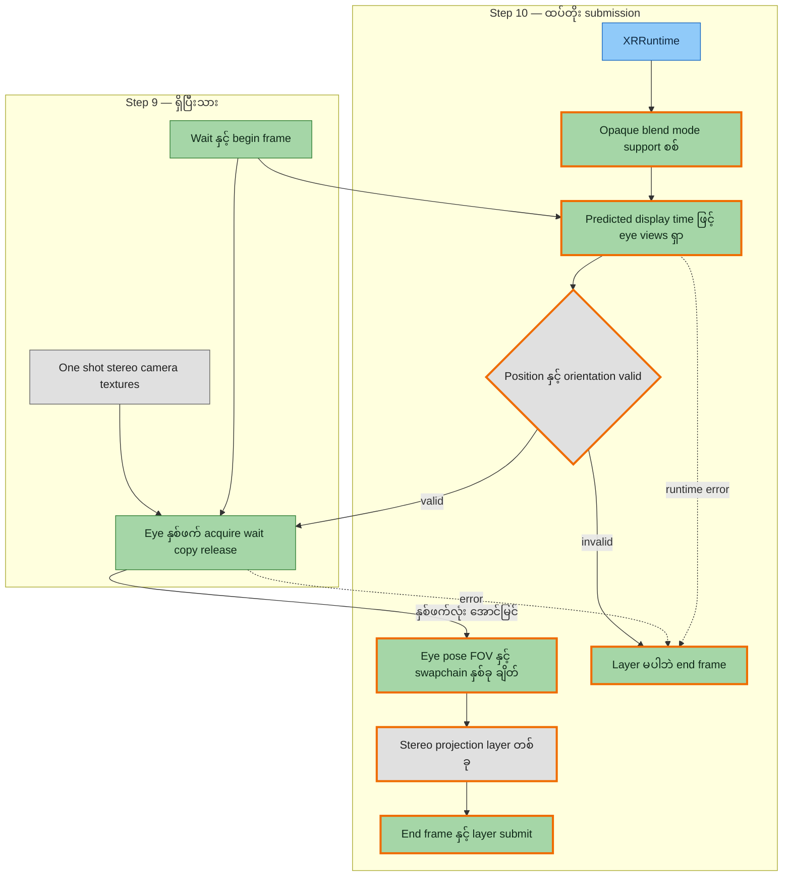

# $\color{#00c853}{\text{OpenXR Stereo Projection Layer Submission}}$

Project: [openxr_ws/gz-harmonic/gazebo_openxr_step10_openXR_stereo_projection_layer_submission](../openxr_ws/gz-harmonic/gazebo_openxr_step10_openXR_stereo_projection_layer_submission)။
Reference: [10_Step 30: OpenXR Stereo Projection Layer Submission.md](<./10_Step 30: OpenXR Stereo Projection Layer Submission.md>)။

## $\color{red}{\text{Step 9 ထက် ထပ်တိုးထားသည်များ}}$



လိမ္မော်ရောင် ဘောင်များသည် [Step 9](./09_OGRE2_RenderCopytoOpenXR.md) ထက် ထပ်တိုးထားသော အပိုင်းများဖြစ်သည်။ Runtime က primary stereo အတွက် opaque blend mode ကို support လုပ်ကြောင်း အရင်စစ်သည်။ `shouldRender` ဖြစ်ပြီး camera textures နှင့် swapchains ready ဖြစ်လျှင် predicted display time နှင့် local reference space ဖြင့် `xrLocateViews` ခေါ်သည်။

Position နှင့် orientation **valid** ဖြစ်သော eye view နှစ်ခုရပြီး နှစ်ဖက်လုံး copy/release အောင်မြင်မှ view တစ်ဖက်စီ၏ pose၊ FOV နှင့် သီးခြား swapchain ကို projection layer တစ်ခုထဲထည့်၍ `xrEndFrame` သို့ ပို့သည်။ `layerCount = 1` ဆိုသည်မှာ eye တစ်ဖက်တည်း မဟုတ်ဘဲ view နှစ်ခုပါသော layer တစ်ခုဖြစ်သည်။

Tracking မရသော frame၊ `shouldRender` မဖြစ်သော frame သို့မဟုတ် texture မရသေးသော frame ကို layer မပါဘဲ end လုပ်သည်။ Tracking ပြန်ရလျှင် ထပ် submit လုပ်သည်။ Locate၊ copy သို့မဟုတ် release တွင် error ဖြစ်လျှင်လည်း begin လုပ်ပြီးသား frame ကို end လုပ်ရန် ကြိုးစားပြီး session stop တောင်းသည်။ Wait မအောင်မြင်သော acquired image ကို release မလုပ်ဘဲ session teardown လုပ်ရန် လိုသည်။

**ကန့်သတ်ချက်:** ဤသည် one-shot Gazebo camera image ကို frame တိုင်း ပြန်တင်သည့် diagnostic ဖြစ်သည်။ OpenXR pose ကို layer အတွက်သာ သုံးပြီး Gazebo camera သို့ မချိတ်သေးပါ။ Camera FOV/projection နှင့် headset FOV လည်း မကိုက်ညီသေးသဖြင့် head motion၊ depth နှင့် distortion သည် မှန်ကန်မည်မဟုတ်ပါ။ `glFinish` နှင့် color handling သည် [Step 9](./09_OGRE2_RenderCopytoOpenXR.md) အတိုင်း diagnostic သာဖြစ်သည်။

**သတိ:** Static image နှင့် မကိုက်ညီသော head motion ကြောင့် မအီမသာ ဖြစ်နိုင်သည်။ အန္တရာယ်ကင်းသောနေရာတွင် ထိုင်၍ ခဏသာ စမ်းပါ။ မအီမသာဖြစ်လျှင် ချက်ချင်းရပ်ပါ။

## $\color{red}{\text{Q1. VR headset မပါဘဲ run လို့ရသလား}}$

ရပါသည်။ Gazebo GUI ၏ **Test Stereo Rendering** ဖြင့် temporary texture diagnostic ကို စမ်းနိုင်ပြီး automated tests ဖြင့် mock OpenXR projection data နှင့် OpenGL pixel copy ကို သီးခြားစစ်နိုင်သည်။ တကယ့် headset ပေါ် projection မြင်ရန် opaque blend mode ကို support လုပ်သော OpenXR runtime၊ headset နှင့် X11/GLX context လိုသည်။

## $\color{red}{\text{Q2. Project ကို ဘယ်လိုဖွင့်မလဲ}}$

Gazebo Harmonic၊ OGRE2 rendering plugin၊ OpenXR၊ Qt 5၊ OpenGL နှင့် X11 development dependencies များဖြင့် build နှင့် test လုပ်ပါ။

```bash
# CLI
cd ~/Desktop/Git/openxr_developers/openxr_ws/gz-harmonic/gazebo_openxr_step10_openXR_stereo_projection_layer_submission
cmake -S . -B build -DCMAKE_BUILD_TYPE=Release
cmake --build build -j4
ctest --test-dir build --output-on-failure
```

X11 display မရှိလျှင် OpenGL နှင့် live GUI test များ skipped ဖြစ်မည်။ တူညီသော project directory မှ GUI ဖွင့်ပါ။

```bash
# GUI
export GZ_GUI_PLUGIN_PATH="$PWD/build"
gz sim --force-version 8 -v 4 shapes.sdf
```

Gazebo ၏ **⋮** မှ **GazeboOpenXR** ကိုရွေးပါ။ VR မပါဘဲ **Test Stereo Rendering** ကို စမ်းနိုင်သည်။ တကယ့် projection အတွက် runtime နှင့် headset ကို ချိတ်ပြီး **Start VR Session** ကို နှိပ်ပါ။ Plugin အမည်များတူသောကြောင့် Step 10 build path ကိုသာ `GZ_GUI_PLUGIN_PATH` တွင် ထည့်ပါ။

ပထမ successful `xrEndFrame` နောက် panel တွင် `Stereo projection layer submitted (diagnostic)` ပေါ်မည်။ 120 frame တိုင်း terminal တွင် view positions နှင့် `Submitted layers` ကို ပြသည်။ Submit success သည် headset တွင် image မှန်ကန်စွာ မြင်ရကြောင်း အာမခံချက်မဟုတ်ပါ။ Error ဖြစ်လျှင် terminal ကိုစစ်ပြီး session ရပ်ကာ ပြန်စတင်ပါ။ Plugin unload မလုပ်မီ session ရပ်ပါ။