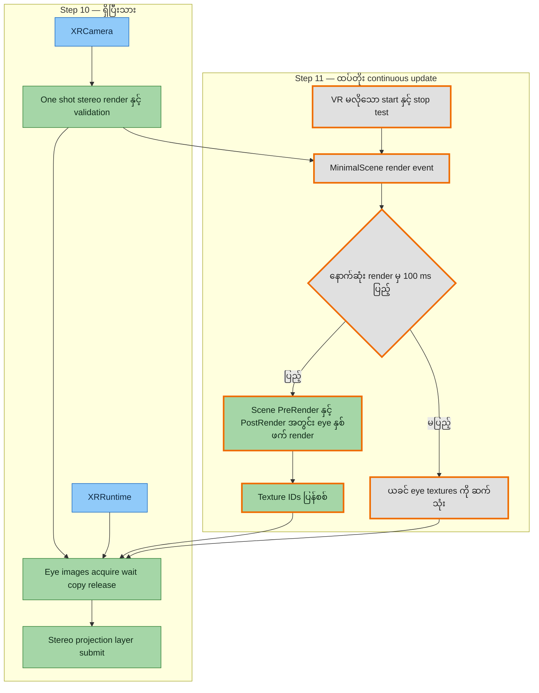

# $\color{#00c853}{\text{Continuous Stereo Rendering}}$

Project: [openxr_ws/gz-harmonic/gazebo_openxr_step11_continuous_stereo_rendering](../openxr_ws/gz-harmonic/gazebo_openxr_step11_continuous_stereo_rendering)။
Reference: [11_Step31:ContinuousStereoRendering.md](./11_Step31:ContinuousStereoRendering.md)။

## $\color{red}{\text{Step 10 ထက် ထပ်တိုးထားသည်များ}}$



လိမ္မော်ရောင် ဘောင်များသည် [Step 10](./10_OpenXR_Stereo_Projection_Layer_Submission.md) ထက် ထပ်တိုးထားသော အပိုင်းများဖြစ်သည်။ ပထမ stereo render နှင့် validation ပြီးနောက် Gazebo render thread တွင် eye နှစ်ဖက်ကို scene cycle တစ်ခုအတွင်း ထပ် render လုပ်သည်။ Render ပြီးဆုံးချိန်မှ အနည်းဆုံး `100 ms` စောင့်ပြီးမှ နောက်တစ်ကြိမ် render လုပ်သောကြောင့် **10 FPS အများဆုံး diagnostic** ဖြစ်သည်။ GUI event rate နှင့် rendering load ကြောင့် အမှန်တကယ် FPS ပိုနည်းနိုင်သည်။

OpenXR frame loop ကို runtime က ထိန်းသည်။ Stereo update ကြားရှိ XR frames များတွင် ယခင် texture ကို ဆက်သုံးသည်။ Texture IDs ပြောင်းလျှင် ပြန် validate လုပ်သည်။ Update မအောင်မြင်လျှင် အဟောင်းကို success ဟုမတင်ဘဲ error ပြပြီး VR session stop တောင်းသည်။ Step 10 ၏ view validity၊ swapchain cycle နှင့် projection layer စစ်ဆေးမှုများ ဆက်ရှိသည်။

Reference တွင် GLEW framebuffer pointers မ initialize ဖြစ်ခြင်းကို ဖော်ပြထားသည်။ ဤ project တွင် [Step 9](./09_OGRE2_RenderCopytoOpenXR.md) အတိုင်း OpenGL core functions ကို တိုက်ရိုက် link လုပ်ပြီး GLX context နှင့် OpenGL version ကို စစ်သည်။ Scene lifecycle ကို စမ်းသပ်ထားသော Gazebo GUI 8.5 `MinimalScene` နှင့် OGRE2 ပေါ် အခြေခံထားသည်။

**ကန့်သတ်ချက်:** Scene ပြောင်းလဲမှုကို update လုပ်သော်လည်း Gazebo camera pose သည် headset ကို မလိုက်သေးပါ။ Eye FOV/projection မကိုက်ညီသေးသလို color accuracy နှင့် frame timing လည်း production အတွက် မစစ်ရသေးပါ။ `glFinish` သည် diagnostic အတွက် GPU ကို စောင့်သောကြောင့် performance ကုန်ကျသည်။

**သတိ:** 10 FPS နှင့် head motion/FOV မကိုက်ညီခြင်းကြောင့် မအီမသာ ဖြစ်နိုင်သည်။ အန္တရာယ်ကင်းသောနေရာတွင် ထိုင်၍ ခဏသာ စမ်းပါ။ မအီမသာဖြစ်လျှင် ချက်ချင်းရပ်ပါ။

## $\color{red}{\text{Q1. VR headset မပါဘဲ run လို့ရသလား}}$

ရပါသည်။ Gazebo GUI ၏ **Start Continuous Test** ဖြင့် stereo camera update ကို headset မပါဘဲ စမ်းပြီး **Stop Continuous Test** ဖြင့် ရပ်နိုင်သည်။ **Test Stereo Rendering** သည် ယခင် one-shot diagnostic အဖြစ် ဆက်ရှိသည်။ Automated tests က rate limit နှင့် stereo pixel ပြောင်းလဲမှုကို စစ်သည်။ တကယ့် OpenXR copy နှင့် headset projection အတွက် runtime၊ headset နှင့် X11/GLX context လိုသည်။

## $\color{red}{\text{Q2. Project ကို ဘယ်လိုဖွင့်မလဲ}}$

Gazebo Harmonic၊ OGRE2 rendering plugin၊ OpenXR၊ Qt 5၊ OpenGL နှင့် X11 development dependencies များဖြင့် build နှင့် test လုပ်ပါ။

```bash
# CLI
cd ~/Desktop/Git/openxr_developers/openxr_ws/gz-harmonic/gazebo_openxr_step11_continuous_stereo_rendering
cmake -S . -B build -DCMAKE_BUILD_TYPE=Release
cmake --build build -j4
ctest --test-dir build --output-on-failure
```

X11 display မရှိလျှင် OpenGL နှင့် live GUI test များ skipped ဖြစ်မည်။ တူညီသော project directory မှ GUI ဖွင့်ပါ။

```bash
# GUI
export GZ_GUI_PLUGIN_PATH="$PWD/build"
gz sim --force-version 8 -v 4 shapes.sdf
```

Gazebo ၏ **⋮** မှ **GazeboOpenXR** ကိုရွေးပါ။ Headset မပါဘဲ စမ်းရန် **Start Continuous Test** ကိုနှိပ်ပါ။ Panel သို့မဟုတ် sidebar အတွင်း scroll လုပ်နိုင်သည်။ တကယ့် projection အတွက် runtime နှင့် headset ကို ချိတ်ပြီး **Start VR Session** ကိုနှိပ်ပါ။ Plugin အမည်များတူသောကြောင့် Step 11 build path ကိုသာ `GZ_GUI_PLUGIN_PATH` တွင် ထည့်ပါ။

Panel တွင် `Continuous stereo test running` ပေါ်ပြီး terminal တွင် continuous stereo frame 60 တိုင်း log ထွက်မည်။ **Stop Continuous Test** သည် headset မပါသော test ကိုသာ ရပ်သည်။ VR session running ဖြစ်နေပါက VR rendering ဆက်လုပ်မည်။ **Stop VR Session** သည် session နှင့် test ကို ရပ်ရန် သုံးပါ။ Plugin unload မလုပ်မီ session ရပ်ပါ။

## $\color{red}{\text{Q3. ဘာကြောင့် 10 FPS ပဲရတာလဲ}}$

[XRCamera.cc](../openxr_ws/gz-harmonic/gazebo_openxr_step11_continuous_stereo_rendering/src/XRCamera.cc) တွင် stereo render တစ်ခုပြီးတိုင်း အနည်းဆုံး `100 ms` စောင့်ရန် သတ်မှတ်ထားသောကြောင့် ဖြစ်သည်။ `1000 ms ÷ 100 ms = 10 FPS` သည် **အများဆုံးနှုန်း** ဖြစ်ပြီး rendering နှင့် GUI event စောင့်ချိန်ကြောင့် လက်တွေ့တွင် ပိုနည်းနိုင်သည်။

ဤ limit သည် continuous OGRE2 rendering တည်ငြိမ်မှုကို အရင်စမ်းရန် reference က သတ်မှတ်ထားသော diagnostic limit ဖြစ်သည်။ Hardware ၏ အမြင့်ဆုံး FPS ကို ဆိုလိုခြင်းမဟုတ်ပါ။ OpenXR frame loop နှင့် headset refresh rate သည် သီးခြားဖြစ်ပြီး stereo image အသစ်မရသေးသော frame များတွင် ယခင် image ကို ပြန်သုံးသည်။

နောက်ပိုင်း interval ကို လျှော့၍ FPS တိုးစမ်းနိုင်သော်လည်း အမှန်တကယ်ရရှိမည့်နှုန်းသည် rendering load၊ GUI event timing နှင့် GPU synchronization ပေါ် မူတည်သည်။ Head tracking နှင့် FOV မကိုက်ညီသေးသောကြောင့် headset ဖြင့် စမ်းရာတွင် အထက်ပါ သတိပေးချက်ကို လိုက်နာပါ။